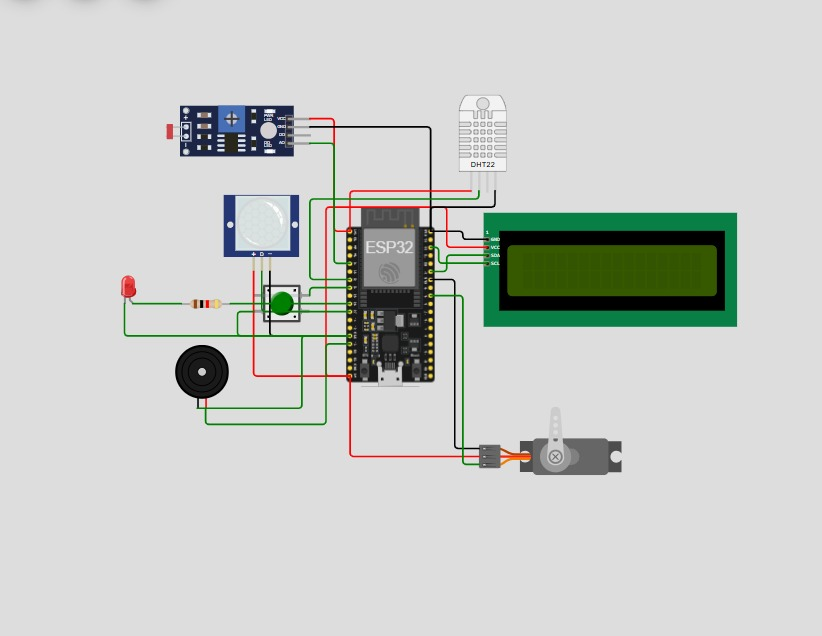

# 🐢 KELOMPOK PENYU
# 🏠 SMART HOME AUTOMATION SYSTEM
## Sistem Otomasi dan Keamanan Rumah Berbasis ESP32 dan Internet of Things (IoT)

---

### 📌 Deskripsi Project

Smart Home Automation System merupakan sebuah sistem otomasi rumah berbasis **Internet of Things (IoT)** yang menggunakan mikrokontroler ESP32 sebagai pusat pengendali.

Project ini dirancang untuk meningkatkan keamanan dan kenyamanan rumah melalui integrasi berbagai sensor, aktuator, dan sistem komunikasi IoT.

Sistem mampu melakukan monitoring suhu, kelembapan udara, intensitas cahaya, pergerakan manusia, serta mendeteksi keberadaan api. Selain itu, sistem dilengkapi dengan otomatisasi pintu menggunakan servo motor, sistem alarm keamanan berbasis buzzer dan LED, serta monitoring data melalui protokol MQTT yang terhubung dengan EMQX Cloud.

---

### 🚀 Fitur Utama

1. **Temperature & Humidity Monitoring (DHT22):** Memantau suhu dan kelembapan udara di sekitar rumah secara berkala.

2. **Light Intensity Detection (LDR):** Mendeteksi intensitas cahaya untuk menentukan kondisi lingkungan terang atau gelap.

3. **Motion Detection (PIR Sensor):** Mendeteksi pergerakan manusia di sekitar area rumah sebagai bagian dari sistem keamanan.

4. **Automatic Door System (Servo Motor):** Membuka dan menutup pintu secara otomatis berdasarkan hasil deteksi pergerakan manusia.

5. **Fire Detection System (Flame Sensor):** Mendeteksi keberadaan api menggunakan Digital Output (DO) sebagai sistem peringatan dini.

6. **Smart Security Alarm:** Menggunakan LED merah, LED hijau, dan buzzer sebagai indikator kondisi lingkungan dan keamanan rumah.

7. **Manual Alarm Control:** Menggunakan push button untuk mengaktifkan atau menonaktifkan sistem alarm.

8. **LCD Monitoring (I2C 16x2):** Menampilkan informasi suhu, kelembapan, kondisi cahaya, deteksi api, status pintu, dan status alarm.

9. **IoT Monitoring (MQTT):** Mengirimkan data sensor dan status sistem ke EMQX Cloud setiap 5 detik untuk monitoring jarak jauh.

---

### 🛠️ Komponen yang Digunakan

**1. Mikrokontroler**
- ESP32 DevKit

**2. Sensor**
- DHT22 (Sensor suhu dan kelembapan udara)
- LDR (Sensor intensitas cahaya)
- PIR Sensor (Sensor pergerakan manusia)
- Flame Sensor (Sensor pendeteksi api)

**3. Aktuator dan Output**
- Servo Motor (Otomatisasi pintu)
- LED Merah (Indikator kondisi)
- LED Hijau (Indikator kondisi api aman)
- Buzzer (Alarm peringatan)
- LCD I2C 16x2 (Display informasi)

**4. Input Control**
- Push Button (Kontrol manual alarm)

**5. Komponen Pendukung**
- Resistor
- Breadboard
- Jumper Wires
- Kabel USB

---

### 📍 Konfigurasi Pin ESP32

Berikut merupakan konfigurasi pin GPIO yang digunakan dalam sistem Smart Home Automation:

| No. | Komponen | Pin ESP32 |
|---|---|---|
| 1 | LDR Sensor | GPIO 34 |
| 2 | DHT22 | GPIO 32 |
| 3 | PIR Sensor | GPIO 27 |
| 4 | LED Merah | GPIO 26 |
| 5 | LED Hijau | GPIO 14 |
| 6 | Buzzer | GPIO 13 |
| 7 | Servo Motor | GPIO 18 |
| 8 | Push Button | GPIO 33 |
| 9 | Flame Sensor (DO) | GPIO 5 |
| 10 | LCD SDA | GPIO 21 |
| 11 | LCD SCL | GPIO 22 |

**Catatan:** Konfigurasi pin disesuaikan dengan definisi pada program `main.cpp`.

---

### 📌 Logika Kerja Sistem

Sistem bekerja dengan membaca data dari setiap sensor yang terhubung ke ESP32. Data tersebut kemudian diproses untuk menentukan tindakan otomatis sesuai kondisi lingkungan.

**1. Monitoring Suhu dan Kelembapan (DHT22)**

- Sensor membaca suhu dan kelembapan udara setiap 2 detik.
- Suhu di atas 30°C dikategorikan sebagai kondisi panas.
- Kondisi suhu panas akan mengaktifkan LED merah.
- Hasil pembacaan ditampilkan melalui LCD dan dikirimkan ke MQTT.

**2. Deteksi Intensitas Cahaya (LDR)**

- Sensor LDR membaca intensitas cahaya melalui input analog.
- Sistem melakukan pembacaan rata-rata sebanyak 10 kali untuk memperoleh nilai yang lebih stabil.
- Nilai di bawah 1900 dikategorikan sebagai kondisi gelap.
- Nilai di atas 2100 mengembalikan status menjadi terang.
- Sistem menggunakan hysteresis untuk mencegah perubahan status yang terlalu cepat.

**3. Deteksi Pergerakan Manusia (PIR Sensor)**

- Sensor PIR mendeteksi pergerakan manusia di sekitar rumah.
- Sistem melakukan warm-up selama 30 detik setelah dinyalakan.
- Perubahan status gerakan menggunakan waktu stabilisasi selama 10 detik.
- Ketika gerakan terdeteksi, sistem akan membuka pintu secara otomatis menggunakan servo motor.

**4. Otomatisasi Pintu (Servo Motor)**

- Ketika gerakan terdeteksi, servo motor membuka pintu pada sudut 90°.
- Ketika tidak ada gerakan, pintu akan menutup pada sudut 0°.
- Pintu memiliki waktu minimum terbuka selama 5 detik untuk mencegah pintu menutup terlalu cepat.

**5. Deteksi Api (Flame Sensor)**

- Flame Sensor membaca kondisi api melalui Digital Output (DO).
- Sistem melakukan kalibrasi awal untuk menentukan kondisi normal sensor.
- Jika api terdeteksi, LED hijau akan mati.
- LED merah akan menyala dan buzzer akan berbunyi apabila alarm diaktifkan.

**6. Sistem Alarm Keamanan**

- LED merah menyala ketika suhu panas, kondisi lingkungan gelap, atau api terdeteksi.
- Buzzer berbunyi ketika kondisi gelap disertai suhu panas atau ketika api terdeteksi.
- Push button digunakan untuk mengaktifkan atau menonaktifkan alarm.
- Sistem menggunakan buzzer dengan dua frekuensi untuk menghasilkan pola suara sirene.

**7. Monitoring LCD**

LCD I2C 16x2 menampilkan informasi secara bergantian dalam tiga halaman:

- Halaman 1: Suhu dan kelembapan.
- Halaman 2: Kondisi cahaya dan deteksi api.
- Halaman 3: Status pintu dan alarm.

Setiap halaman berganti setiap 3 detik.

---

### ☁️ Integrasi Internet of Things (MQTT)

Sistem menggunakan protokol **MQTT (Message Queuing Telemetry Transport)** untuk mengirimkan informasi dari ESP32 menuju EMQX Cloud.

Komunikasi ini memungkinkan data sensor dan status sistem dikirimkan melalui jaringan WiFi sehingga dapat dipantau menggunakan MQTT Client.

**Konfigurasi MQTT:**

| Parameter | Keterangan |
|---|---|
| MQTT Broker | EMQX Cloud |
| Protocol | MQTT over TLS |
| Port | 8883 |
| Topic | `smarthome/telemetri` |
| Publish Interval | 5 detik |
| MQTT Client | ESP32 |

**Data Telemetri yang Dikirimkan:**

| Parameter | Keterangan |
|---|---|
| suhu | Suhu udara (°C) |
| kelembapan | Kelembapan udara (%) |
| ldr | Nilai intensitas cahaya |
| gelap | Status kondisi gelap (1/0) |
| adaApi | Status deteksi api (1/0) |
| pintuTerbuka | Status pintu (1/0) |
| alarm | Status aktivasi alarm (1/0) |

**Contoh Payload JSON:**

```json
{
  "suhu": 31.5,
  "kelembapan": 65.0,
  "ldr": 1500,
  "gelap": 1,
  "adaApi": 0,
  "pintuTerbuka": 1,
  "alarm": 1
}
```

Data dikirimkan dalam format JSON melalui MQTT dengan topic `smarthome/telemetri` setiap 5 detik.

---

### 📦 Pustaka (Library) yang Dibutuhkan

Sebelum menjalankan program, pastikan library berikut telah tersedia melalui PlatformIO Library Manager atau konfigurasi project.

1. **DHT sensor library** – Adafruit.
2. **Adafruit Unified Sensor** – Adafruit.
3. **LiquidCrystal_I2C** – Frank de Brabander.
4. **ESP32Servo** – Kevin Harrington dan John K. Bennett.
5. **PubSubClient** – Nick O'Leary.

Library bawaan ESP32 Arduino Framework:
- Arduino.h
- Wire.h
- WiFi.h
- WiFiClientSecure.h

---

### ⚙️ Cara Instalasi & Penggunaan

**1. Persiapkan Komponen**

Siapkan ESP32, sensor DHT22, LDR, PIR, Flame Sensor, servo motor, LCD I2C, LED, buzzer, dan push button.

**2. Hubungkan Komponen ke ESP32**

Hubungkan seluruh komponen sesuai konfigurasi pin GPIO yang telah ditentukan pada program.

- LDR → GPIO 34
- DHT22 → GPIO 32
- PIR → GPIO 27
- Flame Sensor → GPIO 5
- LED Merah → GPIO 26
- LED Hijau → GPIO 14
- Buzzer → GPIO 13
- Servo Motor → GPIO 18
- Push Button → GPIO 33
- SDA / SCL → GPIO 21 / GPIO 22

**3. Buka Project**

Buka repository project menggunakan Visual Studio Code yang telah dilengkapi PlatformIO IDE.

**4. Konfigurasi WiFi dan MQTT**

Sesuaikan konfigurasi jaringan WiFi dan EMQX Cloud pada konfigurasi lokal yang aman.

Pastikan SSID, password WiFi, MQTT Broker, port, username, dan password sudah benar.

**5. Build Program**

Gunakan menu PlatformIO untuk melakukan proses Build program.

**6. Upload Program**

Hubungkan ESP32 ke komputer, kemudian lakukan Upload program melalui PlatformIO.

**7. Monitoring Sistem**

Buka Serial Monitor dengan kecepatan 115200 baud untuk melihat status operasional sistem secara real-time.

**8. Monitoring MQTT**

Hubungkan MQTT Client ke EMQX Cloud dan lakukan subscribe pada topic:

`smarthome/telemetri`

---

### 🔌 Circuit Diagram

Berikut merupakan diagram rangkaian Smart Home Automation System berbasis ESP32 yang dirancang menggunakan Wokwi.



Rangkaian ini menggambarkan integrasi ESP32 dengan berbagai sensor dan aktuator sebagai bagian dari sistem monitoring lingkungan dan keamanan rumah.

---

### 💡 Catatan Tambahan

- Pastikan seluruh komponen terhubung sesuai konfigurasi pin GPIO pada program.
- Pastikan koneksi WiFi tersedia agar ESP32 dapat terhubung dengan EMQX Cloud.
- Lakukan kalibrasi Flame Sensor ketika sistem pertama kali dijalankan.
- Sensor PIR membutuhkan waktu warm-up selama 30 detik setelah sistem dinyalakan.
- Sistem alarm dapat diaktifkan atau dinonaktifkan menggunakan Push Button.
- Pastikan sumber daya listrik mencukupi untuk ESP32 dan seluruh komponen, khususnya servo motor.
- Pastikan alamat I2C LCD sesuai dengan konfigurasi program, yaitu `0x27`.
- Simpan kredensial WiFi dan MQTT secara aman serta jangan mengunggah password asli ke repository publik.

---

### 📂 Struktur Repository

```text
KELOMPOK-PENYU/
│
├── include/
├── lib/
├── src/
│   └── main.cpp
├── test/
│
├── circuit-diagram.png
├── diagram.json
├── platformio.ini
├── wokwi.toml
├── .gitignore
└── README.md
```

---

**🐢 KELOMPOK PENYU**

*Smart Home Automation System Based on ESP32 and Internet of Things (IoT)*
